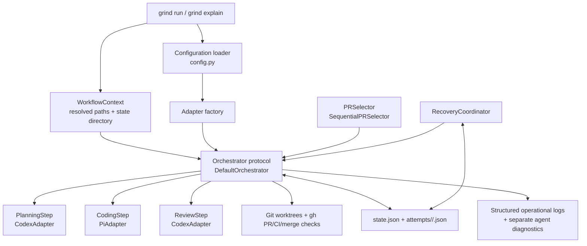
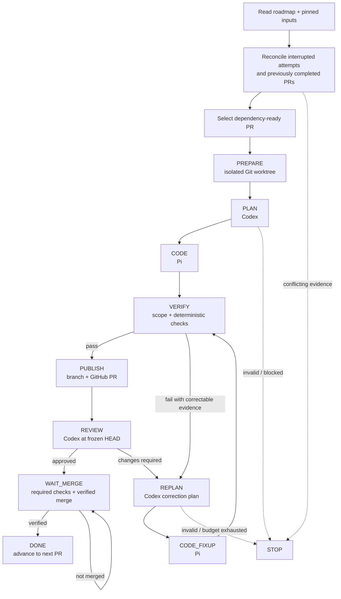
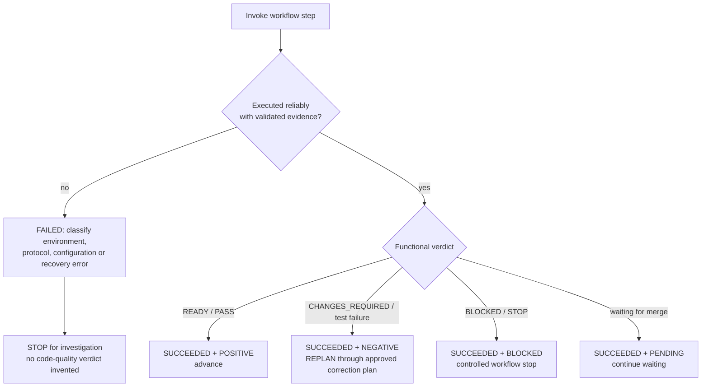
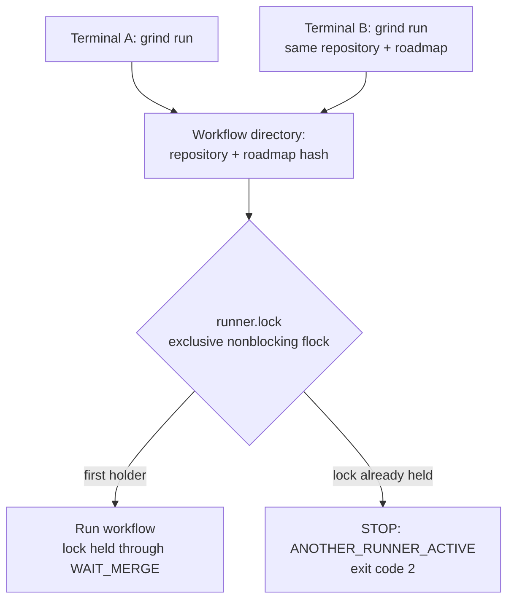
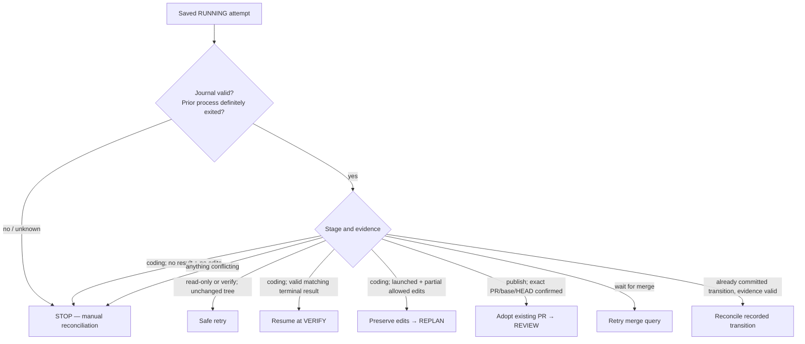
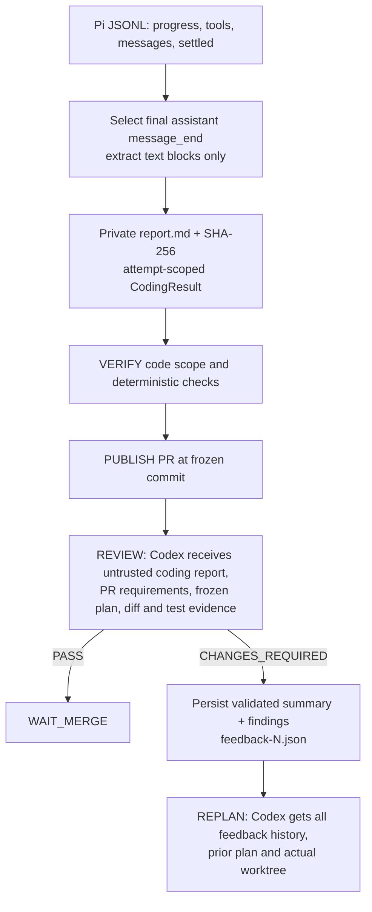

# Codegrinder architecture

Codegrinder automates an *ordered series of pull requests (PRs)* described in a Markdown roadmap. A PR is one independently reviewable unit of work. The tool is called `grind` on the command line. It coordinates specialized coding agents but keeps workflow decisions—what to work on, when changes are acceptable, and when to move to another PR—in a deterministic Python orchestrator.

> **Maturity:** This is an integration pilot. Its mock-adapter and crash-window tests are not a substitute for a live, isolated Codex/Pi/GitHub acceptance test. Automatic merges should remain disabled until that test and the repository's branch protections have been verified.

## Architecture at a glance



The CLI assembles the components; it is **not** the workflow engine. The engine depends on interfaces (Python protocols), not hardcoded agent implementations. The two Codex instances may have different configured models/reasoning levels. The coding adapter is the only agent step authorized to modify the dedicated worktree. Git and GitHub evidence—not a model's declaration—decide whether a change was published or merged.

## Main interfaces and default implementations

| Contract or component | Default implementation / location | Responsibility |
| --- | --- | --- |
| `Orchestrator.run() -> int` | `DefaultOrchestrator` in `engine.py` | Execute/resume the whole roadmap; enforce stages, validation, evidence, and fail-closed stops |
| `WorkflowContext` | Immutable data class in `interfaces.py` | Supply resolved repository, roadmap, guide, state directory, configuration hash, and logging settings |
| `PRSelector.next_pr(prs, entries)` | `SequentialPRSelector` in `selection.py` | Choose the first unfinished PR, rejecting unmet dependencies; never declare a merge |
| `PlanningStep` | `CodexAdapter` in `adapters/codex.py` | Produce schema-constrained, read-only initial/correction plans |
| `CodingStep` | `PiAdapter` in `adapters/pi.py` | Implement the frozen plan in a worktree; emit structured `CodingResult` and sanitized progress |
| `ReviewStep` | `CodexAdapter` in `adapters/codex.py` | Independently inspect the published commit and return a structured review |
| `PreflightCheck.preflight(...)` | Both default adapters | Verify the configured harness credentials and **exact** model availability before work starts |
| Restart reconciliation | `RecoveryCoordinator` in `recovery_runner.py` | Evaluate interrupted attempts against journal, process, worktree, and GitHub evidence |
| Compatibility API | `Controller` in `engine.py` | Retain the older controller construction API; new integrations should use `Orchestrator` |

The step contracts live in `src/codegrinder/interfaces.py`. Planning and review accept `StructuredTask` and return validated JSON-like dictionaries. Coding accepts `CodingTask` and returns `CodingResult` (including PR/attempt identity, model, completion status, exit code, event counts, session ID if available, and restricted diagnostic-file paths). A `CodingProgress` callback provides progress **without** raw prompts or tool output. All three step interfaces extend `PreflightCheck` and expose `identity()` so a resumed workflow can detect adapter changes.

`GrindConfig.adapters()` in `config.py` constructs the adapters. This is the substitution point for future adapters; **today** configuration supports Codex for planning/review and Pi for coding only. Selecting a different adapter name stops rather than silently switching.

## How a PR moves through the workflow



A rejection never sends review findings straight to coding. Instead the orchestrator persists `feedback-N.json`, asks the planner for `plan-fixup-N.md` incorporating the previous plan, feedback, code, tests, decision matrix, and stop conditions, and only then permits `CODE_FIXUP`. Verification failures follow the same replan-first principle. The roadmap's fixup budget bounds correction cycles. The selector does not advance until the corresponding GitHub PR is **confirmed merged** on the expected base; status words such as `DONE` in Markdown are only hints requiring reconciliation.

At startup the CLI also runs the adapters' preflights (after restart reconciliation). Codex checks login and makes an ephemeral read-only request with the selected model and reasoning effort. Pi checks authentication and performs a no-tools/no-session model probe, rejecting unexpected provider/model substitution. Errors stop execution. `grind explain` deliberately performs **none** of these agent or GitHub operations.

## Step execution status versus functional outcome

Codegrinder makes a deliberate distinction between **whether a step executed
reliably** and **what a successfully executed step concluded**. A review that
finds defects is not a broken review invocation. Conversely, a missing
executable or an exhausted disk is not evidence that the code is defective.

Each orchestrator stage records a structured `StepResult` containing the stage,
step name, attempt ID, execution status, functional outcome, native verdict,
and (only for execution failures/interruptions) an error category and code.
The results are persisted in the PR's `step_results` history and
`last_step_result`, with the current attempt's `step_result` also mirrored
into the durable `state.json`/attempt journal. These values are distinct from
the **PR stage** (`REVIEW`, `REPLAN`, etc.) and from the attempt journal's
terminal status (`SUCCEEDED`, `FAILED`, `RECOVERED`, `INTERRUPTED`).

| Dimension | Values | Interpretation |
| --- | --- | --- |
| Execution status | `SUCCEEDED`, `FAILED`, `INTERRUPTED` | Whether this stage invocation produced a trustworthy result; interrupted attempts have no assumed quality verdict |
| Functional outcome | `POSITIVE`, `NEGATIVE`, `BLOCKED`, `PENDING` | What an actually completed invocation concluded; **null** for failed/interrupted execution |
| Native verdict | `READY`, `PASS`, `CHANGES_REQUIRED`, `CHECKS_FAILED`, `STOP`, etc. | Preserves the stage-specific meaning rather than reducing it to a boolean |
| Failure category | `ENVIRONMENT`, `PROTOCOL`, `CONFIGURATION`, `RECOVERY` | Populated **only** when execution failed or was interrupted, with a sanitized machine-readable error code |



### Typical outcomes and transitions

| Stage / condition | Execution status | Outcome / verdict | Action |
| --- | --- | --- | --- |
| `PLAN` or `REPLAN`, validated `READY` plan | `SUCCEEDED` | `POSITIVE / READY` | Advance to coding |
| `PLAN` or `REPLAN`, valid `BLOCKED` response | `SUCCEEDED` | `BLOCKED / BLOCKED` | Stop for operator attention, **not** an adapter malfunction |
| `CODE`/`CODE_FIXUP`, valid terminal result and final report | `SUCCEEDED` | `POSITIVE / COMPLETED` | Verify implementation; this does **not** certify code quality |
| `VERIFY`, all checks pass | `SUCCEEDED` | `POSITIVE / CHECKS_PASSED` | Publish |
| `VERIFY`, trustworthy test assertion failure | `SUCCEEDED` | `NEGATIVE / CHECKS_FAILED` | Persist structured feedback and replan |
| `REVIEW`, validated `PASS` | `SUCCEEDED` | `POSITIVE / PASS` | Wait for verified merge |
| `REVIEW`, validated `CHANGES_REQUIRED` | `SUCCEEDED` | `NEGATIVE / CHANGES_REQUIRED` | Persist feedback and replan |
| `REVIEW`, valid `STOP` | `SUCCEEDED` | `BLOCKED / STOP` | Controlled stop |
| `WAIT_MERGE`, GitHub PR still open | `SUCCEEDED` | `PENDING / WAITING` | Wait/recheck without claiming completion |
| `WAIT_MERGE`, required GitHub CI failed or was canceled | `SUCCEEDED` | `BLOCKED / REQUIRED_CI_FAILED` | Stop for investigation; CI outcome alone does not identify code versus runner failure |
| Missing command, disk exhaustion, unavailable runner | `FAILED` | No functional outcome; `ENVIRONMENT` | Stop; repair execution environment |
| Invalid result schema or unclassifiable check failure | `FAILED` | No functional outcome; `PROTOCOL` | Stop; investigate evidence |
| Interrupted attempt being reconciled | `INTERRUPTED` | No inferred quality verdict; `RECOVERY` | Use the [recovery decision matrix](#recovery-decision-matrix) |

The last item is **not** equivalent to a negative review. A genuine
`CHANGES_REQUIRED` response may exhaust the configured fixup budget: the
review's own result remains `SUCCEEDED / NEGATIVE` while the overall workflow
stops under policy. A successful planner/reviewer call is logged as
`STEP_FINISH disposition=SUCCEEDED`; its functional verdict is separately
recorded in `STEP_RESULT` with `execution_status`, `outcome`, and `verdict`.
The `CHANGES_REQUIRED` transition is logged as `NEGATIVE`, not as a
failed agent invocation. `FAILED` events carry safe `failure_category`
and `error_code` fields; raw tool text and credentials are not included.

The read-only `grind explain` command displays the latest saved step's
execution status, functional outcome, native verdict, failure category and
error code. It also distinguishes `BLOCKED / STOPPED` from an execution
failure when a valid blocking verdict is preserved. These are **offline saved
records**, not proof of a newly reverified GitHub merge or agent execution.

### Deterministic verification: no automatic blaming of the code

`VERIFY` executes trusted roadmap check commands under `bash -lc`.
A nonzero exit code **alone** cannot prove a test failed. The check classifier
first recognizes known infrastructure problems (e.g. missing executables,
shell exit codes 126/127, process termination, `ENOSPC`/disk full, permissions
or memory exhaustion), which produce an **environment execution failure**.
Recognizable assertion/test/linter diagnostics produce a **negative functional
outcome** and enter `REPLAN`. Unrecognized nonzero results fail closed as
`VERIFY_CHECK_UNCLASSIFIED` in the `PROTOCOL` category; they never
automatically authorize the coding agent to change source.

These signatures are deliberately conservative; they are not a semantic
diagnosis of every shell tool. If a check does not expose recognizable failure
evidence, the operator must investigate or improve the check contract.
The orchestrator must not classify infrastructure failures as code defects
merely to keep the automation running.

### Persistence and crash recovery

A normal attempt writes the structured result before marking its attempt
terminal. If a crash interrupts a stage, recovery validates the saved result's
attempt/stage identity and the stage-specific artifacts. Where a committed
stage transition is independently verified, it can reconstruct the corresponding
functional result; a partially executed coding step has **no invented positive
verdict** and remains interrupted. Existing attempt journals retain their
original `RECOVERED` or `INTERRUPTED` recovery status separately from the
new `StepResult` execution dimension.

## Configuration loading and pinning

`cli.py` calls `load_config()` in `config.py`. Without `--conf`, it reads `./grind.toml` in the **current working directory** if present; otherwise built-in agent/logging defaults apply. `--conf PATH` selects a different, **required** TOML file. The loader rejects malformed TOML, unknown keys, unsupported adapters, malformed identifiers, or invalid logging settings. It computes the file's SHA-256 hash when one exists.

The separately resolved roadmap and authoring-guide paths come from `[plan.roadmap].path` and `[plan.guide].path`, overridden individually by `-r/--roadmap` and `-g/--guide`. Both TOML and CLI **relative** paths are relative to the process's current working directory, *not* the configuration file's directory. The CLI constructs `WorkflowContext`, the configured step adapters, and the default orchestrator. The roadmap, guide, configuration hash, and adapter identities are pinned for resumption: conflicting inputs require reconciliation, not implicit acceptance. Details and a complete TOML example are in [Configuration](CONFIGURATION.md).

## Supplemental prompt templates

Each agent phase starts with the **existing orchestrator-generated prompt**. Codegrinder then appends optional, packaged plain-text instructions before calling the adapter. These templates live **inside the Python package**, at `src/codegrinder/prompts/<step>/` in a source checkout (or `codegrinder/prompts/<step>/` in an installed wheel); they are not automatically read from the current target repository.

The step directory names are lowercase: `plan`, `code`, and `review`. A state may override the step-wide prompts with its own lowercase subdirectory; for instance, `PLAN` selects `prompts/plan/plan/` when it exists, while `REPLAN` selects `prompts/plan/replan/`. `CODE_FIXUP` corresponds to `prompts/code/code_fixup/`. The state directory **replaces** step-wide prompts rather than combining with them, even if it contains no matching files. Otherwise, Codegrinder uses matching files immediately inside the step directory.

Only regular `*.prompt.txt` files directly in the selected directory are loaded. Their contents are concatenated in lexicographical filename order and appended to the baseline. Missing directories mean no supplemental content. File names and directory names do not change PR scope or bypass the existing validators. Unknown variables, malformed tokens, unsafe files, or unreadable text stop execution rather than silently omit an instruction.

Supported substitutions include `{{STATE}}`, `{{STEP}}`, `{{PR_ID}}`, `{{PATH_ROADMAP}}`, and `{{PATH_AUTHORING_GUIDE}}`. Planning and replanning also support `{{PATH_GENERATED_PLAN}}`: the absolute destination for `plan.md` or `plan-fixup-N.md` under the workflow state artifacts. Codex receives the destination **as information** and must return the plan through `plan_markdown`; the orchestrator validates and writes the file itself. The bundled `prompts/plan/general.prompt.txt` specifies our low-reasoning-agent planning conventions and benchmarking assumption.

See [Configuration](CONFIGURATION.md#supplemental-prompt-templates) for examples and the variable table.

## Persistent state: where it lives and why

Codegrinder does **not** keep its operational checkpoint inside the project's Git checkout. On Linux, unless `XDG_STATE_HOME` is defined, its root is:

```text
~/.local/state/codegrinder/<workflow-id>/
├── state.json
├── attempts/
│   └── <PR-ID>/
│       └── <attempt-id>.json
├── logs/
│   ├── _run/
│   └── <PR-ID>/
└── ... other workflow artifacts / checkpoints
```

The `<workflow-id>` is the **first 20 lowercase hexadecimal characters** (`0`–`9`, `a`–`f`) of SHA-256 over the **resolved repository path**, a newline, and the **resolved roadmap path**. It is an opaque, deterministic identifier—not a human-readable project name or configurable slug. It therefore **never contains spaces or uppercase letters**. Spaces in repository or roadmap paths are hashed as input; there are no spaces in the output to replace with dashes. Changing either input path changes the identifier, even if the repository contents are identical. Setting `XDG_STATE_HOME` replaces `~/.local/state` as the root. This prevents two checkouts or roadmaps from accidentally sharing a checkpoint. The exact computed `state.json` path is displayed by `grind explain` whenever both repository and roadmap can be resolved. A custom `[logging].directory` relocates **operational logs only**, not `state.json`.

`state.json` is the durable **workflow index/checkpoint**, not a substitute for GitHub or the worktree. It records frozen workflow inputs/adapter identities and per-PR progress: current stage, fixup count, plan/feedback and coding-result references, published PR number/URL/HEAD, accepted review HEAD, merge evidence, and the current execution record (attempt ID, stage, status, baseline, process identity, recovery decision, and terminal evidence where available). The per-attempt JSON files form an audit journal so an interrupted `RUNNING` checkpoint can be correlated with a **specific** invocation. They include baseline Git HEAD, fingerprint of tracked/staged/untracked worktree changes, process identity (including Linux boot and process-start identifiers when available), and sanitized terminal evidence. Raw agent transcripts and secrets are not copied into these records.

State and attempt-journal writes use atomic replacement and file/directory `fsync`. The workflow has a single-runner lock; another invocation cannot concurrently mutate the same workflow. The orchestrator uses its saved state to decide **what to inspect**; it does not interpret saved stage labels or `DONE` as proof that external operations happened.

## Concurrency: running several `grind` instances

Codegrinder supports multiple terminals or processes on one machine, but its
**current mutual-exclusion boundary is the workflow**, not the entire Git
repository or host. This is important when two roadmaps target the same checkout.

### What is locked today

The normal `grind run` CLI computes a state directory from the **resolved Git
repository path** and **resolved roadmap path** (see the preceding section).
The directory contains `runner.lock`, which the CLI opens and locks with an
exclusive, nonblocking Linux advisory filesystem lock:

```python
fcntl.flock(fd, fcntl.LOCK_EX | fcntl.LOCK_NB)
```

If another `grind run` already holds that lock, the second invocation
**does not queue or wait**. It prints `STOP: ANOTHER_RUNNER_ACTIVE` and exits
with status **2**, before it constructs or runs its orchestrator. The lock is
held until that `grind run` exits, including while it remains in
`WAIT_MERGE` awaiting CI or a GitHub merge. The operating system releases the
lock when the file descriptor closes, including after a process terminates;
the `runner.lock` file can remain on disk and should not be manually deleted
to bypass locking.



The lock is **advisory**: it coordinates invocations using the same lock path,
not unrelated programs modifying the checkout. It is acquired by the CLI
(`single_runner` in `engine.py`), not automatically by direct callers of
`DefaultOrchestrator`; embedding applications must provide equivalent
exclusion. `grind explain` is read-only and does not acquire this lock. It can
run alongside a workflow and shows a saved checkpoint, not a synchronized or
GitHub-reverified status.

### Concurrency decision table

| Simultaneous commands or environments | Current outcome | Explanation |
| --- | --- | --- |
| Two `grind run` commands with the same resolved repository and roadmap, using the same state root | **Second stops** | Identical workflow directory and `runner.lock` |
| Same repository and roadmap, but different `grind.toml` or guide options | **Second stops**, if the state root is shared | Configuration and guide do **not** contribute to the workflow ID; they are separately pinned for resume |
| Same repository, **different roadmap paths** | **Both may run** | Different workflow IDs and locks, even when the PRs overlap |
| Different Git repository paths | **Both may run** | Separate workflow IDs and state directories |
| `grind run` beside `grind explain` | **Both permitted** | `explain` reads but does not execute agents or take a runner lock |
| Same repository/roadmap with different `XDG_STATE_HOME` values | **Both may run** | Different lock-file roots defeat mutual exclusion |
| Direct `DefaultOrchestrator` usage without caller-managed locking | **No CLI lock guaranteed** | The caller bypasses `single_runner` |

**Risk when different roadmaps share one repository:** Even though their state
and worktree paths are separate, both may create or update a Git branch named
`prflow/<PR-ID>`, publish conflicting GitHub PRs, interfere with Git worktree
and ref operations, or modify overlapping code. Tests and performance
benchmarks may also contend for CPU, memory, disk or network resources—even
when the workflows use different repositories. Distinct state directories are
**not** proof of safe parallel operation.

### Recommended stronger model — not implemented

A future concurrency design should introduce two complementary levels of
mutual exclusion, acquired in a consistent order and released reliably:

| Proposed lock | Scope | Purpose |
| --- | --- | --- |
| Repository lock | One canonical Git checkout, **independent of roadmap or state directory** | Prevent overlapping PR/branch/worktree operations by different roadmaps |
| Workflow lock (existing) | Resolved repository + roadmap | Protect a particular workflow's state, journal and recovery |

For reproducible performance benchmarks, a separate **optional host-level
resource lock** could prevent workflows in *different repositories* from
benchmarking on the same host simultaneously. This is a proposed safeguard,
not a capability available in the current implementation.

**Operational guidance until these safeguards are implemented:** Run at most
one `grind run` against a given Git repository at a time, use a consistent
`XDG_STATE_HOME`, and do not launch concurrent performance benchmarks on a
shared host. Codegrinder's existing workflow-scoped lock prevents duplicated
invocations of *one* workflow; it does **not** enforce repository-wide or
host-wide isolation.

## Explicit PR selection and controlled forced planning

Normally `grind run` uses the injected `PRSelector` to execute the
first unfinished eligible roadmap PR and continue through later PRs.
The operator can instead specify **one exact roadmap identifier**:

```bash
grind run --pr BM-15
grind run --pr BM-15 -f
# or: grind run --pr BM-15 --force
```

Identifiers are matched **exactly** to roadmap `## <PR-ID>: ...` headings;
spaces are not permitted by the versioned roadmap parser (`"PR 15"`
is not a valid ID; `PR-15` or `BM-15` is). `--pr` executes **only that
PR**, not all remaining roadmap entries. Once GitHub confirms the selected
PR merged, the invocation exits without claiming the whole roadmap is done.
`-f/--force` is invalid without `--pr`.

### Normal explicit selection

Before launching agents, Codegrinder inspects all saved PR entries under
the workflow's exclusive `runner.lock`. It distinguishes a **recovery
conflict** (e.g. an interrupted `RUNNING` attempt or failed attempt) from
a **selection conflict** (e.g. another PR legitimately waiting for merge).
An explicit selection never silently recovers an unrelated incomplete PR.

If there is any conflict, `grind run --pr BM-15` returns a warning and
does not start agents:

```text
STOP: RECOVERY_REQUIRED: requested BM-15; unfinished execution: ...
Run 'grind run' to reconcile the existing workflow, or
'grind run --pr BM-15 -f' to request a controlled fresh PLAN.
```

For a healthy unfinished previous PR the warning begins
`PR_SELECTION_CONFLICT`. Neither warning claims that force is always safe
or available. An unknown PR ID, already merged PR, invalid input, or
unmerged/unverified required dependency is rejected regardless of force.
Completed dependencies are **reverified against GitHub**, not assumed
from a saved `DONE` label.

### Forced supersession — safety boundary

`grind run --pr BM-15 -f` authorizes abandoning an unfinished *operator
workflow*, **not** deleting its evidence, bypassing source scope restrictions,
or killing a previous agent process. Before changing state, the orchestrator
rejects:

- Any previous worker that is still **ACTIVE**, whose identity/status is
  **UNKNOWN**, or whose launch is ambiguous without a recorded process ID
- An interrupted untracked `PUBLISH` / GitHub operation, invalid attempt
  journal, or legacy state without sufficient evidence
- The target PR already published under its previous execution (requires
  external GitHub reconciliation first)
- Any unmet dependency, existing candidate branch/worktree, active runner
  lock, or unverified repo state
- Any configuration/roadmap/guide hash mismatch, or failed agent preflight

After these checks, Codegrinder persists an audit event, marks eligible
previous `RUNNING` attempts `SUPERSEDED`, and retains their process
evidence and journals. Older, unfinished PR entries become `STOPPED` with
a `superseded_by` reference, so normal sequential execution does not
silently restart them. A previous attempt of the **selected** PR is
snapshotted under `<state-dir>/overrides/<PR-ID>/<generation>.json`
and referenced by its SHA-256 digest. Original logs and artifacts are
retained.

The new planning attempt uses a **distinct branch, worktree, and artifact
directory**, based on a monotonically increasing generation:

```text
branch:       prflow/BM-15-force-00000001
worktree:     <state-dir>/worktrees/BM-15-force-00000001
new artifacts:<state-dir>/artifacts/BM-15-force-00000001
old artifacts:<state-dir>/artifacts/BM-15       (untouched)
```

Any existing file changes in the previous worktree remain untouched.
No previous branch is reset, PR is deleted, or verification/review check
is bypassed. The newly selected PR begins at **PLAN**, then follows the
usual plan/coding/verification/publication/review/merge state machine. An
additional force invocation creates a *new* generation, not a reuse of the
earlier forced worktree. If the prior target has a published PR, an operator
must reconcile/close that PR first rather than creating a competing PR with
the same roadmap identifier.

The lifecycle emits `PR_SELECTION_OVERRIDE`,
`RECOVERY_OVERRIDE_REQUESTED`, `RECOVERY_OVERRIDE_APPROVED`,
`ATTEMPT_SUPERSEDED`, and `FORCED_PLANNING_STARTED` events as
applicable. `state.json` retains the last selected override and an
append-only list of override metadata; `grind explain` reports the
latest stored selection and supersession. It does **not** claim a force
operation is safe from offline evidence alone; process, Git, and workspace
checks are performed only by the locked execution path.

### Operator decision table

| Requested action and evidence | Decision |
| --- | --- |
| `grind run` | Existing automatic crash recovery then sequential PR selection |
| `grind run --pr BM-15`, no conflicting state, satisfied dependencies | Run only BM-15 from its existing durable stage |
| `--pr` while another attempt needs recovery or another PR is unfinished | Stop with actionable warning; no silent recovery |
| `--pr BM-15 -f`, previous agents provably exited, no remote target conflicts | Audit supersession, create isolated workspace, start fresh PLAN |
| `--force` but prior worker is active/unknown, Git operation ambiguous, or journal invalid | Stop for manual reconciliation |
| `--force` but required dependency not verified merged | Stop; never skip dependency |
| `--force` and target already published or completed | Stop; do not create duplicate PR |
| `grind run -f` without `--pr` | Invalid configuration |

The override changes **selection** and the authorized planning workspace,
not the workflow's correctness contracts. The existing per-workflow lock
still does not provide a repository-wide lock; concurrent separate
roadmaps remain unsafe (see [Concurrency](#concurrency-running-several-grind-instances)).

## Restart and crash recovery

Recovery is **evidence-driven and fail-closed**. Before launching agents or selecting another PR, `RecoveryCoordinator.reconcile()` inspects unfinished attempts, ensures the matching journal is present and valid, checks whether a prior agent process is still active (guarding against PID reuse), compares the current worktree to the baseline, and examines any attempt-specific terminal or publishing evidence. An already committed transition is checked against the artifacts required for its destination stage.



### Recovery decision matrix

This table summarizes the *implemented* conservative outcomes. Rows are evaluated only after checkpoint/journal integrity and prior-process safety have been established. An ambiguous branch always stops; a “retry” does not mean the system ignores identity or worktree checks.

| Observed condition at restart | Required evidence/guard | Recovery decision |
| --- | --- | --- |
| No interrupted attempt; ordinary saved checkpoint | Inputs and prior completion evidence remain reconcilable | Continue normal processing |
| `RUNNING` attempt missing/invalid journal, or legacy in-progress state without attempt evidence | None can establish safe execution identity | **STOP** for manual reconciliation |
| Prior process active or process identity uncertain | Cannot prove the old worker exited | **STOP**; do not launch duplicate agent |
| Attempt began but launch is recorded `NOT_STARTED` | Baseline/preparation evidence consistent | Retry preparation; coding may retry if worktree exactly matches baseline |
| Interrupted `PLAN`, `REPLAN`, `REVIEW`, or `VERIFY` | Previous process exited, matching HEAD and unchanged fingerprint; read-only rules respected | Safe retry same stage |
| Interrupted `PLAN`/`REPLAN` while process launch is uncertain | `LAUNCHING` but no process identity | **STOP** |
| Interrupted `CODE` or `CODE_FIXUP`, trusted successful `CodingResult` | Same attempt/PR/phase/model; successful exit; validated allowed paths and HEAD | Record result and resume at `VERIFY`; **do not recode** |
| Coding not launched | `NOT_STARTED` with identical baseline snapshot | Retry coding |
| Coding process exited, no valid result, *partial changed* worktree | Known exited process; same HEAD; every changed file is in allowed scope | Keep partial edits; create recovery feedback; enter `REPLAN` before any further coding |
| Coding launched, no trusted result and *unchanged* worktree | External side effects cannot be excluded | **STOP**, not a speculative retry |
| Coding result missing/malformed/mismatched or edits out of scope | Terminal proof or scope integrity fails | **STOP** |
| Interrupted `PUBLISH` | Existing PR uniquely matches expected branch, base, and worktree HEAD | Adopt confirmed PR; move to `REVIEW` (never blindly recreate) |
| Publish cannot be confirmed, conflicts with recorded SHA/base/number | Inadequate GitHub evidence | **STOP** |
| Interrupted `WAIT_MERGE` | Safe to check external merge status again | Retry merge query; only confirmed merge advances roadmap |
| Stage advanced in `state.json` but attempt still `RUNNING` | Transition legal and stage-specific artifact/PR/merge evidence valid | Mark committed transition reconciled, not a duplicate execution |
| Changed HEAD, modified read-only worktree, invalid attempt/state, missing evidence, unknown stage | Cannot prove safe continuation | **STOP** |

A stop requires operator investigation; Codegrinder does not guess whether an external side effect occurred. In particular, this design does **not** guarantee exactly-once execution of arbitrary agent actions. `grind explain` provides a read-only snapshot of the saved attempt and possible recovery blocker; it does **not** execute reconciliation or repair state.

## Structured agent handoffs: coding report and independent review

The coding harness (Pi) writes a JSONL event stream containing progress,
intermediate assistant/tool messages, and terminal events. The adapter drains
stdout/stderr concurrently to restricted diagnostic artifacts, but does **not**
pass that full stream to Codex. It selects the **last completed assistant
`message_end`**, checks that the process exited successfully and the agent
emitted a non-aborted `agent_settled`, verifies provider/model identity, and
extracts only `type: "text"` content blocks. Tool results, thinking blocks,
intermediate assistant messages and raw stderr are excluded.

The nonempty, size-bounded final report is stored as an attempt-specific
`<phase>-<fixup-number>-<attempt-id>.report.md` under
`<state-dir>/artifacts/<PR-ID>/` (for example,
`code-0-BM-01-00000001.report.md`). The report is written privately and
atomically. The normalized `CodingResult` records its exact path and
SHA-256 digest along with existing process/attempt metadata; `state.json`
stores that result and the latest successful coding attempt ID. A completed
process without validated report evidence is **not** a completed coding step.



Before passing the report to review, the orchestrator independently derives its
expected artifact path from PR, phase, fixup number and attempt ID, verifies
that it belongs to the **latest coding attempt**, checks its digest, validates
size and encoding, and refuses symlinks. The review prompt treats the report
as **untrusted claims**, not permission to bypass reviewing the actual Git diff,
required checks or acceptance criteria. After a fixup, the reviewer receives
the **fixup report**, not the superseded initial coding report.

On crash recovery, the same evidence checks apply before a recovered coding
attempt can advance to `VERIFY`; a missing, mismatched, invalid or tampered
report causes a fail-closed stop, never speculative re-execution. Previously
saved coding results without the report metadata cannot be assumed safe to
recover. The attempt journal remains the authority for whether the original
worker exited.

By contrast, Codex planning/review uses `--output-schema` and a dedicated
JSON artifact, rather than parsing its console narration. The review result
must have a validated `verdict`, `summary`, and structured `findings`.
On `CHANGES_REQUIRED`, Codegrinder writes versioned `feedback-N.json` and
supplies its **summary and findings**, including earlier feedback history,
to the same PR's next planning invocation. Deterministic verification failures
use the same replanning path with synthetic structured findings. The reviewer
does not directly invoke coding: `REPLAN` must produce an approved plan
before `CODE_FIXUP`.

The implementation boundaries are
`adapters/pi.py` (JSONL consumption),
`coding_reports.py` (shared extraction and integrity validation),
`interfaces.py` (`CodingResult`),
`engine.py` (prompt handoffs), `adapters/codex.py` (schema JSON),
and `recovery_runner.py` (restart reconciliation).

## Observability and relevant source files

The orchestrator logs INFO-level start/finish events around each step, with state, disposition, and duration, plus stop/error events. Console and rotating file outputs are independently configurable and may both be enabled. Persistent file logs default to the state directory's `logs/_run/` and `logs/<PR-ID>/`; raw agent stdout/stderr are separate restricted diagnostics. See [Configuration](CONFIGURATION.md) for log settings.

For further reading: `src/codegrinder/cli.py` (entry point and state path), `config.py` (loader/factory), `interfaces.py` (contracts), `engine.py` (state machine), `selection.py` (PR ordering), `recovery.py` and `recovery_runner.py` (recovery), `diagnostics.py` (`explain`), `run_logging.py` (logging), and `adapters/` (agent harnesses).
