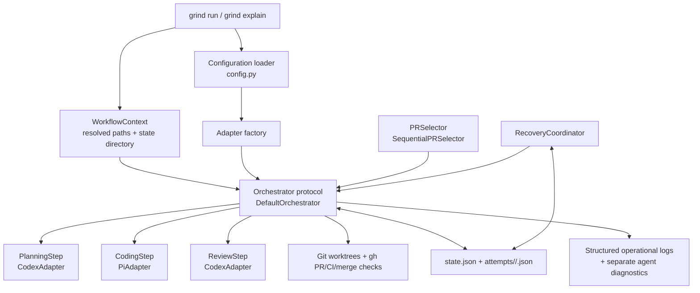
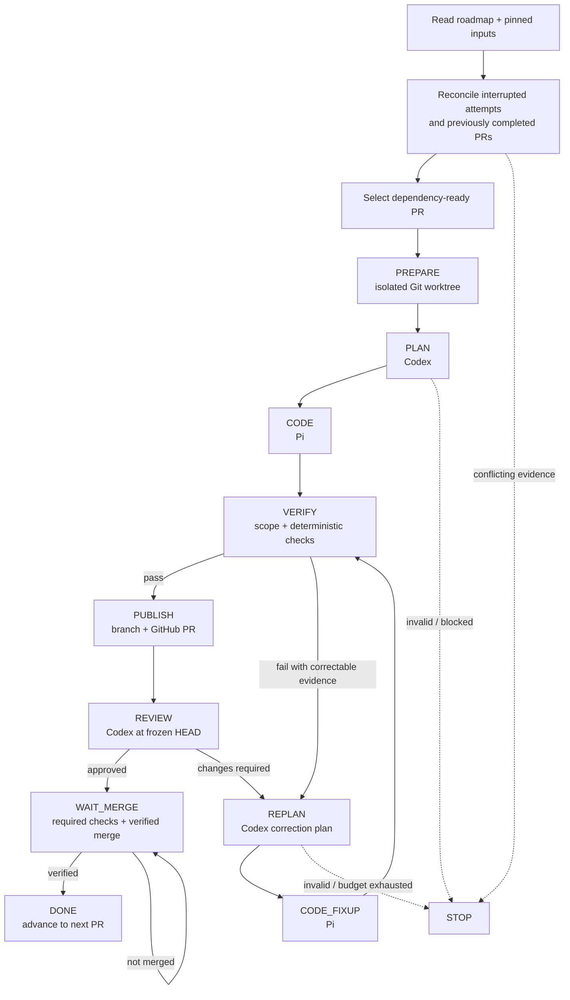
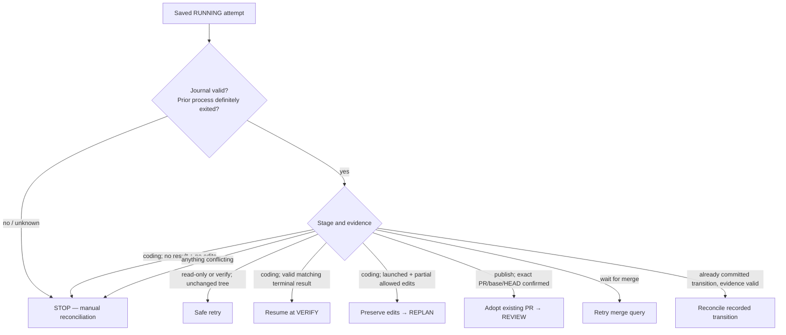
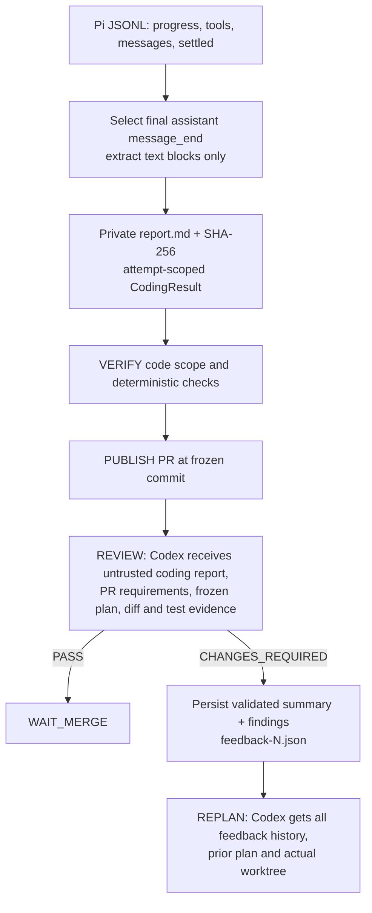

# Codegrinder architecture

Codegrinder automates an *ordered series of pull requests (PRs)* described in a Markdown roadmap. A PR is one independently reviewable unit of work. The tool is called `grind` on the command line. It coordinates specialized coding agents but keeps workflow decisions—what to work on, when changes are acceptable, and when to move to another PR—in a deterministic Python orchestrator.

> **Maturity:** This is an integration pilot. Its mock-adapter and crash-window tests are not a substitute for a live, isolated Codex/Pi/GitHub acceptance test. Automatic merges should remain disabled until that test and the repository's branch protections have been verified.

## Architecture at a glance



The CLI assembles the components; it is **not** the workflow engine. The engine depends on interfaces (Python protocols), not hardcoded agent implementations. The two Codex instances may have different configured models/reasoning levels. The coding adapter is the only agent step authorized to modify the dedicated worktree. Git and GitHub evidence—not a model's declaration—decide whether a change was published or merged.

## Main interfaces and default implementations

| Contract or component | Default implementation / location | Responsibility |
| --- | --- | --- |
| `Orchestrator.run() -> int` | `DefaultOrchestrator` in `engine.py` | Execute/resume the whole roadmap; enforce stages, validation, evidence, and fail-closed stops |
| `WorkflowContext` | Immutable data class in `interfaces.py` | Supply resolved repository, roadmap, guide, state directory, configuration hash, and logging settings |
| `PRSelector.next_pr(prs, entries)` | `SequentialPRSelector` in `selection.py` | Choose the first unfinished PR, rejecting unmet dependencies; never declare a merge |
| `PlanningStep` | `CodexAdapter` in `adapters/codex.py` | Produce schema-constrained, read-only initial/correction plans |
| `CodingStep` | `PiAdapter` in `adapters/pi.py` | Implement the frozen plan in a worktree; emit structured `CodingResult` and sanitized progress |
| `ReviewStep` | `CodexAdapter` in `adapters/codex.py` | Independently inspect the published commit and return a structured review |
| `PreflightCheck.preflight(...)` | Both default adapters | Verify the configured harness credentials and **exact** model availability before work starts |
| Restart reconciliation | `RecoveryCoordinator` in `recovery_runner.py` | Evaluate interrupted attempts against journal, process, worktree, and GitHub evidence |
| Compatibility API | `Controller` in `engine.py` | Retain the older controller construction API; new integrations should use `Orchestrator` |

The step contracts live in `src/codegrinder/interfaces.py`. Planning and review accept `StructuredTask` and return validated JSON-like dictionaries. Coding accepts `CodingTask` and returns `CodingResult` (including PR/attempt identity, model, completion status, exit code, event counts, session ID if available, and restricted diagnostic-file paths). A `CodingProgress` callback provides progress **without** raw prompts or tool output. All three step interfaces extend `PreflightCheck` and expose `identity()` so a resumed workflow can detect adapter changes.

`GrindConfig.adapters()` in `config.py` constructs the adapters. This is the substitution point for future adapters; **today** configuration supports Codex for planning/review and Pi for coding only. Selecting a different adapter name stops rather than silently switching.

## How a PR moves through the workflow



A rejection never sends review findings straight to coding. Instead the orchestrator persists `feedback-N.json`, asks the planner for `plan-fixup-N.md` incorporating the previous plan, feedback, code, tests, decision matrix, and stop conditions, and only then permits `CODE_FIXUP`. Verification failures follow the same replan-first principle. The roadmap's fixup budget bounds correction cycles. The selector does not advance until the corresponding GitHub PR is **confirmed merged** on the expected base; status words such as `DONE` in Markdown are only hints requiring reconciliation.

At startup the CLI also runs the adapters' preflights (after restart reconciliation). Codex checks login and makes an ephemeral read-only request with the selected model and reasoning effort. Pi checks authentication and performs a no-tools/no-session model probe, rejecting unexpected provider/model substitution. Errors stop execution. `grind explain` deliberately performs **none** of these agent or GitHub operations.

## Configuration loading and pinning

`cli.py` calls `load_config()` in `config.py`. Without `--conf`, it reads `./grind.toml` in the **current working directory** if present; otherwise built-in agent/logging defaults apply. `--conf PATH` selects a different, **required** TOML file. The loader rejects malformed TOML, unknown keys, unsupported adapters, malformed identifiers, or invalid logging settings. It computes the file's SHA-256 hash when one exists.

The separately resolved roadmap and authoring-guide paths come from `[plan.roadmap].path` and `[plan.guide].path`, overridden individually by `-r/--roadmap` and `-g/--guide`. Both TOML and CLI **relative** paths are relative to the process's current working directory, *not* the configuration file's directory. The CLI constructs `WorkflowContext`, the configured step adapters, and the default orchestrator. The roadmap, guide, configuration hash, and adapter identities are pinned for resumption: conflicting inputs require reconciliation, not implicit acceptance. Details and a complete TOML example are in [Configuration](CONFIGURATION.md).

## Supplemental prompt templates

Each agent phase starts with the **existing orchestrator-generated prompt**. Codegrinder then appends optional, packaged plain-text instructions before calling the adapter. These templates live **inside the Python package**, at `src/codegrinder/prompts/<step>/` in a source checkout (or `codegrinder/prompts/<step>/` in an installed wheel); they are not automatically read from the current target repository.

The step directory names are lowercase: `plan`, `code`, and `review`. A state may override the step-wide prompts with its own lowercase subdirectory; for instance, `PLAN` selects `prompts/plan/plan/` when it exists, while `REPLAN` selects `prompts/plan/replan/`. `CODE_FIXUP` corresponds to `prompts/code/code_fixup/`. The state directory **replaces** step-wide prompts rather than combining with them, even if it contains no matching files. Otherwise, Codegrinder uses matching files immediately inside the step directory.

Only regular `*.prompt.txt` files directly in the selected directory are loaded. Their contents are concatenated in lexicographical filename order and appended to the baseline. Missing directories mean no supplemental content. File names and directory names do not change PR scope or bypass the existing validators. Unknown variables, malformed tokens, unsafe files, or unreadable text stop execution rather than silently omit an instruction.

Supported substitutions include `{{STATE}}`, `{{STEP}}`, `{{PR_ID}}`, `{{PATH_ROADMAP}}`, and `{{PATH_AUTHORING_GUIDE}}`. Planning and replanning also support `{{PATH_GENERATED_PLAN}}`: the absolute destination for `plan.md` or `plan-fixup-N.md` under the workflow state artifacts. Codex receives the destination **as information** and must return the plan through `plan_markdown`; the orchestrator validates and writes the file itself. The bundled `prompts/plan/general.prompt.txt` specifies our low-reasoning-agent planning conventions and benchmarking assumption.

See [Configuration](CONFIGURATION.md#supplemental-prompt-templates) for examples and the variable table.

## Persistent state: where it lives and why

Codegrinder does **not** keep its operational checkpoint inside the project's Git checkout. On Linux, unless `XDG_STATE_HOME` is defined, its root is:

```text
~/.local/state/codegrinder/<workflow-id>/
├── state.json
├── attempts/
│   └── <PR-ID>/
│       └── <attempt-id>.json
├── logs/
│   ├── _run/
│   └── <PR-ID>/
└── ... other workflow artifacts / checkpoints
```

The `<workflow-id>` is the **first 20 lowercase hexadecimal characters** (`0`–`9`, `a`–`f`) of SHA-256 over the **resolved repository path**, a newline, and the **resolved roadmap path**. It is an opaque, deterministic identifier—not a human-readable project name or configurable slug. It therefore **never contains spaces or uppercase letters**. Spaces in repository or roadmap paths are hashed as input; there are no spaces in the output to replace with dashes. Changing either input path changes the identifier, even if the repository contents are identical. Setting `XDG_STATE_HOME` replaces `~/.local/state` as the root. This prevents two checkouts or roadmaps from accidentally sharing a checkpoint. The exact computed `state.json` path is displayed by `grind explain` whenever both repository and roadmap can be resolved. A custom `[logging].directory` relocates **operational logs only**, not `state.json`.

`state.json` is the durable **workflow index/checkpoint**, not a substitute for GitHub or the worktree. It records frozen workflow inputs/adapter identities and per-PR progress: current stage, fixup count, plan/feedback and coding-result references, published PR number/URL/HEAD, accepted review HEAD, merge evidence, and the current execution record (attempt ID, stage, status, baseline, process identity, recovery decision, and terminal evidence where available). The per-attempt JSON files form an audit journal so an interrupted `RUNNING` checkpoint can be correlated with a **specific** invocation. They include baseline Git HEAD, fingerprint of tracked/staged/untracked worktree changes, process identity (including Linux boot and process-start identifiers when available), and sanitized terminal evidence. Raw agent transcripts and secrets are not copied into these records.

State and attempt-journal writes use atomic replacement and file/directory `fsync`. The workflow has a single-runner lock; another invocation cannot concurrently mutate the same workflow. The orchestrator uses its saved state to decide **what to inspect**; it does not interpret saved stage labels or `DONE` as proof that external operations happened.

## Restart and crash recovery

Recovery is **evidence-driven and fail-closed**. Before launching agents or selecting another PR, `RecoveryCoordinator.reconcile()` inspects unfinished attempts, ensures the matching journal is present and valid, checks whether a prior agent process is still active (guarding against PID reuse), compares the current worktree to the baseline, and examines any attempt-specific terminal or publishing evidence. An already committed transition is checked against the artifacts required for its destination stage.



### Recovery decision matrix

This table summarizes the *implemented* conservative outcomes. Rows are evaluated only after checkpoint/journal integrity and prior-process safety have been established. An ambiguous branch always stops; a “retry” does not mean the system ignores identity or worktree checks.

| Observed condition at restart | Required evidence/guard | Recovery decision |
| --- | --- | --- |
| No interrupted attempt; ordinary saved checkpoint | Inputs and prior completion evidence remain reconcilable | Continue normal processing |
| `RUNNING` attempt missing/invalid journal, or legacy in-progress state without attempt evidence | None can establish safe execution identity | **STOP** for manual reconciliation |
| Prior process active or process identity uncertain | Cannot prove the old worker exited | **STOP**; do not launch duplicate agent |
| Attempt began but launch is recorded `NOT_STARTED` | Baseline/preparation evidence consistent | Retry preparation; coding may retry if worktree exactly matches baseline |
| Interrupted `PLAN`, `REPLAN`, `REVIEW`, or `VERIFY` | Previous process exited, matching HEAD and unchanged fingerprint; read-only rules respected | Safe retry same stage |
| Interrupted `PLAN`/`REPLAN` while process launch is uncertain | `LAUNCHING` but no process identity | **STOP** |
| Interrupted `CODE` or `CODE_FIXUP`, trusted successful `CodingResult` | Same attempt/PR/phase/model; successful exit; validated allowed paths and HEAD | Record result and resume at `VERIFY`; **do not recode** |
| Coding not launched | `NOT_STARTED` with identical baseline snapshot | Retry coding |
| Coding process exited, no valid result, *partial changed* worktree | Known exited process; same HEAD; every changed file is in allowed scope | Keep partial edits; create recovery feedback; enter `REPLAN` before any further coding |
| Coding launched, no trusted result and *unchanged* worktree | External side effects cannot be excluded | **STOP**, not a speculative retry |
| Coding result missing/malformed/mismatched or edits out of scope | Terminal proof or scope integrity fails | **STOP** |
| Interrupted `PUBLISH` | Existing PR uniquely matches expected branch, base, and worktree HEAD | Adopt confirmed PR; move to `REVIEW` (never blindly recreate) |
| Publish cannot be confirmed, conflicts with recorded SHA/base/number | Inadequate GitHub evidence | **STOP** |
| Interrupted `WAIT_MERGE` | Safe to check external merge status again | Retry merge query; only confirmed merge advances roadmap |
| Stage advanced in `state.json` but attempt still `RUNNING` | Transition legal and stage-specific artifact/PR/merge evidence valid | Mark committed transition reconciled, not a duplicate execution |
| Changed HEAD, modified read-only worktree, invalid attempt/state, missing evidence, unknown stage | Cannot prove safe continuation | **STOP** |

A stop requires operator investigation; Codegrinder does not guess whether an external side effect occurred. In particular, this design does **not** guarantee exactly-once execution of arbitrary agent actions. `grind explain` provides a read-only snapshot of the saved attempt and possible recovery blocker; it does **not** execute reconciliation or repair state.

## Structured agent handoffs: coding report and independent review

The coding harness (Pi) writes a JSONL event stream containing progress,
intermediate assistant/tool messages, and terminal events. The adapter drains
stdout/stderr concurrently to restricted diagnostic artifacts, but does **not**
pass that full stream to Codex. It selects the **last completed assistant
`message_end`**, checks that the process exited successfully and the agent
emitted a non-aborted `agent_settled`, verifies provider/model identity, and
extracts only `type: "text"` content blocks. Tool results, thinking blocks,
intermediate assistant messages and raw stderr are excluded.

The nonempty, size-bounded final report is stored as an attempt-specific
`<phase>-<fixup-number>-<attempt-id>.report.md` under
`<state-dir>/artifacts/<PR-ID>/` (for example,
`code-0-BM-01-00000001.report.md`). The report is written privately and
atomically. The normalized `CodingResult` records its exact path and
SHA-256 digest along with existing process/attempt metadata; `state.json`
stores that result and the latest successful coding attempt ID. A completed
process without validated report evidence is **not** a completed coding step.



Before passing the report to review, the orchestrator independently derives its
expected artifact path from PR, phase, fixup number and attempt ID, verifies
that it belongs to the **latest coding attempt**, checks its digest, validates
size and encoding, and refuses symlinks. The review prompt treats the report
as **untrusted claims**, not permission to bypass reviewing the actual Git diff,
required checks or acceptance criteria. After a fixup, the reviewer receives
the **fixup report**, not the superseded initial coding report.

On crash recovery, the same evidence checks apply before a recovered coding
attempt can advance to `VERIFY`; a missing, mismatched, invalid or tampered
report causes a fail-closed stop, never speculative re-execution. Previously
saved coding results without the report metadata cannot be assumed safe to
recover. The attempt journal remains the authority for whether the original
worker exited.

By contrast, Codex planning/review uses `--output-schema` and a dedicated
JSON artifact, rather than parsing its console narration. The review result
must have a validated `verdict`, `summary`, and structured `findings`.
On `CHANGES_REQUIRED`, Codegrinder writes versioned `feedback-N.json` and
supplies its **summary and findings**, including earlier feedback history,
to the same PR's next planning invocation. Deterministic verification failures
use the same replanning path with synthetic structured findings. The reviewer
does not directly invoke coding: `REPLAN` must produce an approved plan
before `CODE_FIXUP`.

The implementation boundaries are
`adapters/pi.py` (JSONL consumption),
`coding_reports.py` (shared extraction and integrity validation),
`interfaces.py` (`CodingResult`),
`engine.py` (prompt handoffs), `adapters/codex.py` (schema JSON),
and `recovery_runner.py` (restart reconciliation).

## Observability and relevant source files

The orchestrator logs INFO-level start/finish events around each step, with state, disposition, and duration, plus stop/error events. Console and rotating file outputs are independently configurable and may both be enabled. Persistent file logs default to the state directory's `logs/_run/` and `logs/<PR-ID>/`; raw agent stdout/stderr are separate restricted diagnostics. See [Configuration](CONFIGURATION.md) for log settings.

For further reading: `src/codegrinder/cli.py` (entry point and state path), `config.py` (loader/factory), `interfaces.py` (contracts), `engine.py` (state machine), `selection.py` (PR ordering), `recovery.py` and `recovery_runner.py` (recovery), `diagnostics.py` (`explain`), `run_logging.py` (logging), and `adapters/` (agent harnesses).
