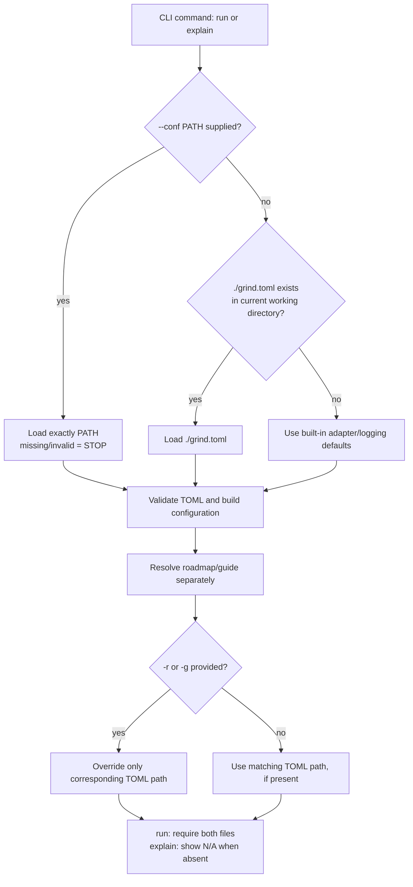

# Configuring Codegrinder

Codegrinder's `grind` CLI executes a PR roadmap. You can configure its plan/code/review models, roadmap and authoring-guide files, and operational logging in a TOML file called `grind.toml`. A TOML file is a human-readable text file with named tables such as `[steps.plan]` and `key = value` entries. The repository includes a copyable [example](../grind.toml.example).

## Quick start

From the target Git checkout, copy `grind.toml.example` to `grind.toml`, edit the roadmap and guide paths, and inspect the result before running:

```bash
cp grind.toml.example grind.toml
grind explain
grind run
```

`grind explain` reads configuration and saved state but **does not** invoke agents, contact GitHub, change the worktree, or write logs/checkpoints. `grind run` requires a valid roadmap and authoring guide, both individually configured in TOML or supplied as CLI flags.

## Complete TOML structure

```toml
# Paths are relative to your current working directory, NOT this file.
[plan.roadmap]
path = "docs/ROADMAP.v1.md"

[plan.guide]
path = "docs/DETAILED_PR_PLAN_AUTHORING_GUIDE.md"

[steps.plan]
adapter = "codex"
model = "gpt-6-sol"
reasoning_effort = "high"

[steps.code]
adapter = "pi"
provider = "deepseek"
model = "deepseek-flash"
thinking = "high"

[steps.review]
adapter = "codex"
model = "gpt-6-sol"
reasoning_effort = "high"

[logging]
level = "INFO"
max_bytes = 10485760
backup_count = 5
stdout = true
files = true
# directory = "/tmp/codegrinder/my-project"
```

This is the structure currently accepted by `config.py`. Sections may be omitted if their values have built-in defaults; the roadmap and guide have **no** built-in path defaults. You may put `grind.toml` outside the repository and point to it with `--conf`.

### Tables and values

| TOML key | Meaning | Default / rules |
| --- | --- | --- |
| `[plan.roadmap].path` | Versioned Markdown PR roadmap | No default; required by `run` unless `-r` is supplied |
| `[plan.guide].path` | Detailed PR plan authoring guide | No default; required by `run` unless `-g` is supplied |
| `[steps.plan].adapter` | Planning harness | `codex` only |
| `[steps.plan].model` | Exact planning model ID passed to Codex | `gpt-6-sol` |
| `[steps.plan].reasoning_effort` | Codex reasoning effort | `high`; one of `low`, `medium`, `high`, `xhigh` |
| `[steps.code].adapter` | Coding harness | `pi` only |
| `[steps.code].provider` | Provider ID passed to Pi | `deepseek` |
| `[steps.code].model` | Exact coding model ID | `deepseek-flash` |
| `[steps.code].thinking` | Pi thinking level | `high`; one of `off`, `minimal`, `low`, `medium`, `high`, `xhigh`, `max` |
| `[steps.review].adapter` | Independent review harness | `codex` only |
| `[steps.review].model` | Exact reviewing model ID | `gpt-6-sol` |
| `[steps.review].reasoning_effort` | Codex reviewing effort | `high`; same choices as planning |
| `[logging].level` | Operational log severity threshold | `INFO` |
| `[logging].max_bytes` | Size of each rotating log file | `10485760` (10 MiB) |
| `[logging].backup_count` | Number of rotated backups per log | `5` |
| `[logging].stdout` | Emit operational logs to stdout | `true` |
| `[logging].files` | Emit rotating operational log files | `true` |
| `[logging].directory` | Optional **log** root, with `_run/` and `<PR-ID>/` children | By default, workflow state directory's `logs/` |

Both `logging.stdout` and `logging.files` can be enabled at once; disabling both is rejected. The directory setting changes **logs only**, not the persistent workflow checkpoint or attempt journal. Avoid storing credentials in the TOML file; configure agent authentication in Codex and Pi themselves. Model IDs are passed exactly to the harnesses and preflight-checked; Codegrinder does not auto-substitute another model.

## Configuration discovery, precedence, and overrides



The CLI offers **path overrides**, not CLI switches for models, provider, thinking effort, or log rotation. Those belong in TOML. Precedence for each roadmap/guide path is **CLI flag > TOML path > unspecified**. For the model and logging settings, **TOML value > built-in default**.

| CLI syntax | Purpose | Configuration relationship |
| --- | --- | --- |
| `grind run` | Execute or resume the roadmap | Uses TOML paths or requires both path flags |
| `grind explain` | Inspect resolved settings and saved workflow state (offline/read-only) | Optional paths display as N/A |
| `grind --conf PATH run` | Select another TOML file | Overrides default `./grind.toml` discovery; explicit file must exist |
| `grind run --conf PATH` | Equivalent placement after the command | Same effect; specify `--conf` only once |
| `grind --conf PATH explain` / `grind explain --conf PATH` | Inspect settings from a selected file | Same file-selection behavior |
| `-r PATH` / `--roadmap PATH` | Select the roadmap | Overrides **only** `[plan.roadmap].path` |
| `-g PATH` / `--guide PATH` | Select the guide | Overrides **only** `[plan.guide].path` |
| `grind --help`, `grind run --help`, `grind explain --help` | Show help | Do not execute a workflow |

For example, this leaves the configured guide intact while temporarily selecting a different roadmap:

```bash
grind run --roadmap /work/project/docs/ROADMAP.v2.md
```

This loads a configuration file elsewhere, while resolving **its relative path values against the current working directory**:

```bash
grind --conf /etc/codegrinder/team.toml explain
```

All CLI and TOML paths support `~` expansion; relative paths are resolved against the process's **current working directory**. Locating `--conf` in another directory never changes that base. The same rule applies to `[logging].directory`.

## State versus logs

A configured project does not automatically store its workflow progress in `grind.toml` or in the repository. The default durable location is:

```text
${XDG_STATE_HOME:-~/.local/state}/codegrinder/<workflow-id>/state.json
```

`<workflow-id>` is the **first 20 lowercase hexadecimal characters** (`0`–`9`, `a`–`f`) of the SHA-256 digest of the resolved Git repository path, a newline, and the resolved roadmap path. It is an opaque identifier, never a directory-name slug: it contains **no spaces or uppercase letters** (so whitespace-to-dash replacement is not applicable). This is why the roadmap location matters: changing `-r` can select a **different** workflow state directory. `grind explain` prints the exact computed path, its file status, and the last known PR/step when available. The sibling `attempts/` journal supports crash recovery; consult [Architecture](ARCHITECTURE.md#restart-and-crash-recovery) for the decision matrix.

Operational files default to `<state-dir>/logs/_run/` and `<state-dir>/logs/<PR-ID>/`. Operational logs contain step boundaries, states, dispositions and safe error codes; raw harness stdout/stderr remain separately restricted artifacts. Logging to console and files simultaneously is supported.

## Strictness and predictable errors

Unknown top-level keys or nested configuration keys, unsupported adapters, invalid model/provider ID syntax, invalid reasoning levels, malformed TOML, and invalid logging settings are refused. Explicit `--conf` pointing to a missing file is an error, but a missing **default** `./grind.toml` is allowed. For `run`, a missing required roadmap/guide or nonexistent selected path is an error. `explain` is more tolerant about missing optional paths because its job is diagnostics, but it still reports invalid configuration.

The roadmap itself specifies PR dependencies, allowed paths, validation commands, fixup budget, required checks, and merge rules; these are **workflow specifications**, not `grind.toml` keys. Refer to [the versioned roadmap example](../examples/roadmap.v1.md). Configuration, roadmap, and guide integrity are pinned when a run starts; editing them mid-workflow can require explicit reconciliation instead of seamless resume.

For a conceptual overview of the state machine and injected interfaces, read [Architecture](ARCHITECTURE.md).
