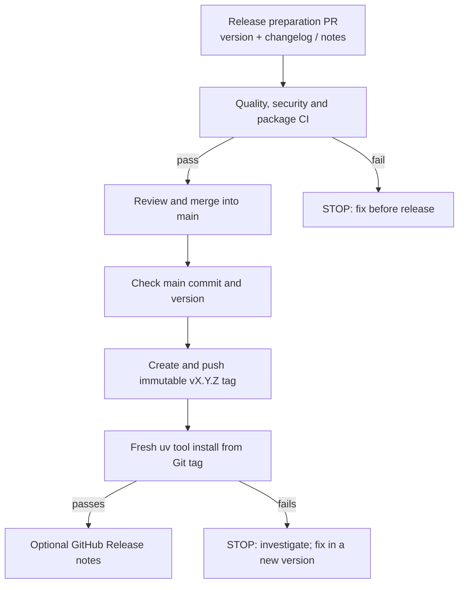

# Releasing Codegrinder from GitHub

Codegrinder currently uses **Git tags in this repository as its release distribution mechanism**. Users install a tagged revision with `uv tool install "git+https://github.com/yduchesne/codegrinder.git@vX.Y.Z"`. We do **not** publish to PyPI, maintain publishing credentials, or upload a Python distribution to a package registry.

A release is intentional and maintainer-driven. **Merging a PR does not create a release**, and this document does not authorize an automated workflow to create or move tags.

## Release overview



GitHub-hosted source is the release artifact: `uv` fetches the tag, builds the Python package, and installs the CLI. A GitHub Release page with human-readable notes is optional; a plain Git tag is sufficient for `uv` installation.

## Version policy

Use a version in Python package metadata (`pyproject.toml`) and in `src/codegrinder/__init__.py`, with a matching Git tag prefixed by `v`.

| Example | Meaning | Installer reference |
| --- | --- | --- |
| `0.1.0a1` | Explicit pre-release / pilot | `@v0.1.0a1` |
| `0.1.0` | Versioned release | `@v0.1.0` |
| `0.1.1` | Patch release for corrections | `@v0.1.1` |

These values are **illustrations**, not a claim that such tags exist. Choose the version in the release PR. Do not reuse a version/tag for different code. Once published, never move or delete a release tag to revise its contents; issue a new version instead.

## Release readiness gates

| Gate | Required result | If not satisfied |
| --- | --- | --- |
| Reviewed source | Release PR merged to `main` | STOP |
| Version consistency | `[project].version` = `codegrinder.__version__` = tag (without `v`) | STOP |
| Quality and security | Required GitHub Actions checks passed (tests, coverage, Ruff, mypy, Bandit, Semgrep, Gitleaks, SBOM) | STOP |
| Build | `uv build --no-sources` creates exactly one wheel and one source distribution | STOP |
| Installability | CI installs **each** distribution separately using `uv tool install` | STOP |
| CLI and resources | Installed `grind --help` and `grind explain --help` work, and JSON schemas are accessible | STOP |
| Git tag | Unique, annotated, pushed from the verified `main` commit | STOP on a mismatch/duplicate |
| External installation | Fresh `uv tool install` from the newly created Git tag works | Investigate; correct via **new** version |

CI's distribution smoke test is independent of the editable development installation. It validates package files, entry points and resource inclusion without launching real agents. Passing CI **does not** demonstrate production-safe unattended orchestration or credentialed GitHub/Codex/Pi integration; those require a separate controlled pilot.

## Procedure for maintainers

### 1. Prepare a release PR

Work in a feature branch. Update the version in:

- `pyproject.toml` — `[project].version`
- `src/codegrinder/__init__.py` — `__version__`

Record meaningful changes in release notes or a changelog entry, and update documentation if installation or configuration has changed. Refresh the lockfile with `uv lock`, and commit it if changed. Do not introduce PyPI workflows or tokens.

Before opening/merging the PR, run:

```bash
uv python install 3.14
uv lock
uv sync --locked --group dev
uv run --no-sync pre-commit run --all-files
uv run --no-sync pytest
uv build --no-sources
```

The pre-commit and CI checks include supply-chain scanning and an SBOM. The distribution smoke test runs in CI; review its **successful status**, not only the Python unit test outcome.

### 2. Merge and validate `main`

After review and passing required checks, merge the release preparation PR into `main`. Then:

```bash
git fetch origin
git switch main
git pull --ff-only origin main
git status --short
```

The working tree must be clean. Confirm the expected version is present at `HEAD` and all required checks have passed for that commit. Do not tag a feature-branch commit or a commit whose results have not been checked.

### 3. Create an annotated Git tag

For example, **only when releasing version 0.1.0**:

```bash
git tag -a v0.1.0 -m "Codegrinder v0.1.0"
git push origin v0.1.0
```

Before creating it, verify that `v0.1.0` does not already exist locally or on the remote. Never force-update an existing release tag. The tag must point at the verified `main` commit. Release tags are explicit maintainer actions, **not** triggered automatically by pushes or PR merges.

### 4. Verify GitHub-based installation

Use an isolated machine, CI runner, or a clean tool environment with `uv`, Git, and Python 3.14 access. For the example release:

```bash
uv tool install --python 3.14 \
  "git+https://github.com/yduchesne/codegrinder.git@v0.1.0"
grind --help
grind explain --help
```

If Codegrinder is already installed, use `uv tool install --reinstall --python 3.14` with the same source URL to replace it deliberately. Verify the installed package version and expected CLI behavior. Real `grind run` acceptance requires separate agents, authentication, an appropriate target repository and isolation; it is not part of this non-agent smoke test.

### 5. Optionally publish GitHub Release notes

A GitHub Release associated with the immutable tag may contain a summary, compatibility changes, migration advice, and installation instructions. It does not require attaching wheel or source archives because `uv` fetches the tag directly. Link to [Installation](INSTALLATION.md).

## Failed release or rollback

| Situation | Action |
| --- | --- |
| CI fails before tagging | Fix the release PR; do **not** tag |
| Incorrect version or tag already exists | STOP; reconcile version and tag identity, never overwrite |
| Install from tag fails | Investigate and fix on a new commit; publish a **new** version/tag |
| A released version is unsafe | Communicate the issue; users should install a known-good earlier tag or a newly fixed tag |
| Need to update a deployment pinned to a tag | Explicitly reinstall from the newer release tag |

Removing or retagging source revisions is not a safe substitute for a corrected release. Because the installer relies on GitHub availability, ensure the repository remains accessible and avoid rewriting published Git history.

## Files involved

- [Installation](INSTALLATION.md) — user installation and upgrade commands
- [Configuration](CONFIGURATION.md) — `grind.toml` settings and CLI overrides
- `pyproject.toml` and `src/codegrinder/__init__.py` — version information
- `.github/workflows/python-tests.yml` — quality checks and isolated wheel/sdist smoke tests
- [Security and SBOM](SECURITY_AND_SBOM.md) — existing quality and supply-chain policy
